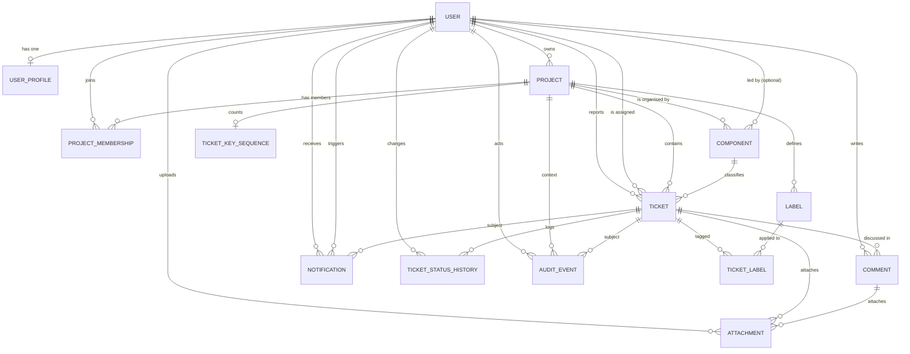

# Entity Relationship Design

Conventions used throughout the schema:

* **Major entities** have a `uuid` primary key (UUIDv7 — see ADR-006); **join tables** use a
  `bigint` surrogate (`TicketLabel`) to keep secondary indexes compact.
* All timestamps are `timestamptz` at the database level and stored in UTC (`USE_TZ = True`).
* `created_at` / `updated_at` come from the `TimeStampedModel` base.
* Text enumerations are `CharField` + `choices` (validated in Python, cheap to migrate) rather
  than native PostgreSQL enums, which are painful to alter (`ALTER TYPE ... ADD VALUE` cannot run
  inside some migrations).
* Every foreign key states its deletion behaviour explicitly — see the table at the end.

## 1. Diagram

## 2. Entities

### User (`accounts`)
Replaces Django's default user (`AUTH_USER_MODEL = "accounts.User"`), created **before the first
migration** — the single most common irreversible mistake in a Django project.

| Field | Type | Rules |
| --- | --- | --- |
| `id` | uuid PK | UUIDv7 |
| `email` | citext-like `EmailField` | **unique**, login identifier, normalised to lowercase |
| `full_name` | varchar(150) | required |
| `system_role` | choices | `ADMIN` / `PROJECT_MANAGER` / `ENGINEER` / `REPORTER`, default `REPORTER` |
| `is_active` | bool | deactivation instead of deletion; `False` blocks login and all API access |
| `is_staff`, `is_superuser` | bool | Django admin access only |
| `date_joined`, `last_login` | timestamptz | managed by Django |

`UserProfile` (1:1, `CASCADE`): `job_title`, `phone`, `timezone`, `avatar_key`, notification
preferences (`notify_on_comment`, `notify_on_assignment`, ...).

### Project (`projects`)

| Field | Type | Rules |
| --- | --- | --- |
| `id` | uuid PK | |
| `key` | varchar(10) | **unique**, uppercase `[A-Z][A-Z0-9]{1,9}`; prefix of ticket keys (`ENG`) |
| `name` | varchar(200) | required |
| `description` | text | optional |
| `owner` | FK User | `PROTECT` — an owner with tickets cannot be deleted |
| `status` | choices | `ACTIVE` / `ARCHIVED`; archive instead of delete |
| `archived_at` | timestamptz | null unless archived |

Index: `(status, key)`.

### ProjectMembership (`projects`)
The pivot that makes "project-level permissions" possible.

| Field | Type | Rules |
| --- | --- | --- |
| `id` | uuid PK | |
| `project` | FK Project | `CASCADE` |
| `user` | FK User | `CASCADE` |
| `role` | choices | `MANAGER` / `ENGINEER` / `REPORTER` (project scope) |
| `is_active` | bool | removing a member deactivates the row and preserves history |
| `joined_at` | timestamptz | |

Constraints: **unique `(project, user)`**; index `(user, is_active)` for "my projects";
check-style rule enforced in `clean()`: the project owner always has an active `MANAGER`
membership (created automatically in `services.projects.create_project`).

### Component (`projects`)
`id` uuid, `project` FK `CASCADE`, `name` varchar(100), `description`, `lead` FK User `SET_NULL`,
`is_active` bool. Constraint: **unique `(project, name)`**.

### Ticket (`tickets`)
The core aggregate.

| Field | Type | Rules |
| --- | --- | --- |
| `id` | uuid PK | |
| `key` | varchar(20) | **unique**, generated `PROJECTKEY-number`, immutable |
| `project` | FK Project | `PROTECT` (archiving, not deleting, is the lifecycle) |
| `component` | FK Component | `SET_NULL`, must belong to `project` (validated in `clean()`) |
| `title` | varchar(255) | required |
| `description` | text | required |
| `type` | choices | `BUG` / `TASK` / `FEATURE` / `CHANGE_REQUEST` / `SUPPORT` |
| `status` | choices | 10 workflow states (see `workflow.md`) — **read-only through the API** |
| `priority` | choices | `LOWEST` → `CRITICAL` — *how soon* |
| `severity` | choices | `TRIVIAL` → `CRITICAL` — *how bad technically* |
| `reporter` | FK User | `PROTECT`, set from `request.user` |
| `assignee` | FK User | `SET_NULL`, must be an active project member (validated in the service) |
| `due_date` | date | optional |
| `resolved_at`, `closed_at` | timestamptz | stamped by the workflow |

Indexes: `(project, status)`, `(project, created_at)`, `(assignee, status)`,
`(project, priority)`, `(component)`; the unique index on `key` doubles as the race guard.

Invariant (service-enforced): `DONE_STATUSES = {RESOLVED, CLOSED}` require an `assignee` and a
`resolved_at`; `DUPLICATE`/`REJECTED` require a comment explaining why.

### TicketKeySequence (`tickets`)
`project` **OneToOne** `CASCADE`, `last_number` positive int (default 0), `updated_at`.
One row per project; the serialisation point for key allocation (ADR-007).

### Comment (`comments`)
`id` uuid, `ticket` FK `CASCADE`, `author` FK User `PROTECT`, `body` text (1..10000),
`is_deleted` bool, `edited_at` timestamptz null, timestamps.
Index: `(ticket, created_at)`. Deletion is **soft** so the audit trail keeps its anchors.

### Attachment (`attachments`)
`id` uuid, `ticket` FK `CASCADE` (null), `comment` FK `CASCADE` (null),
`uploader` FK User `PROTECT`, `file` FileField (storage key = random UUID + extension),
`original_name` varchar(255), `content_type` varchar(100), `size_bytes` positive bigint,
`sha256` char(64), `is_deleted` bool.
Constraint: at least one of `ticket` / `comment` must be set (`CheckConstraint`).
The original filename is stored for display only; it is **never** used as the storage key
(path-traversal and overwrite protection).

### Label / TicketLabel (`tickets`)
`Label`: `id` uuid, `project` FK `CASCADE`, `name`, `color` hex; unique `(project, name)`.
`TicketLabel`: `id` bigint, `ticket` FK `CASCADE`, `label` FK `CASCADE`; unique `(ticket, label)`.

### TicketStatusHistory (`workflows`)
Immutable business timeline.
`id` uuid, `ticket` FK `CASCADE`, `from_status` (null for the creation entry),
`to_status`, `changed_by` FK User `PROTECT`, `comment` text, `created_at`.
Index: `(ticket, created_at)`.

### Notification (`notifications`)
`id` uuid, `recipient` FK User `CASCADE`, `actor` FK User `SET_NULL`, `event_type` choices,
`title`, `body`, `ticket` FK `SET_NULL` (null), `project` FK `SET_NULL` (null),
`payload` JSONB, `dedup_key` varchar(120) **unique, nullable**, `is_sent` bool, `sent_at`,
`is_read` bool, `read_at`, `created_at`.
Index: `(recipient, is_read, created_at)`, `(recipient, created_at)`.

### AuditEvent (`audit`)
Append-only.
`id` uuid, `actor` FK User `SET_NULL` (an event must survive user deletion),
`action` varchar(50) (see `apps/audit/actions.py`), `object_type` varchar(50),
`object_id` uuid (nullable, indexed), `project` FK `SET_NULL`, `ticket` FK `SET_NULL`,
`metadata` JSONB (no secrets, no full payload copies), `ip_address` `GenericIPAddressField`,
`user_agent` varchar(300), `created_at`.
Indexes: `(object_type, object_id)`, `(project, created_at)`, `(actor, created_at)`, `(action)`.

## 3. Deletion behaviour summary

| Relationship | On delete | Why |
| --- | --- | --- |
| User → ProjectMembership | CASCADE | membership is meaningless without the user |
| User → Project.owner | PROTECT | never orphan a project |
| User → Ticket.reporter | PROTECT | reporting history must stay attributable |
| User → Ticket.assignee | SET_NULL | work continues; ticket becomes unassigned |
| User → Comment.author / Attachment.uploader | PROTECT | content stays attributable |
| User → AuditEvent.actor | SET_NULL | audit outlives accounts |
| Project → Component / Membership / Label | CASCADE | project-scoped configuration |
| Project → Ticket | PROTECT | forces archive-then-migrate instead of data loss |
| Ticket → Comment / Attachment / StatusHistory | CASCADE | ticket-scoped content |
| Component → Ticket | SET_NULL | a removed component must not delete tickets |
| Ticket/Comment → Attachment | CASCADE | attachments belong to their anchor |

## 4. Referential integrity beyond foreign keys

1. `Ticket.component.project == Ticket.project` — checked in `Ticket.clean()` and in the service.
2. `Ticket.assignee` is an active member of `Ticket.project` — checked in
   `tickets.services.assign_ticket`.
3. A project always has an active `MANAGER` membership for its owner — ensured on creation and
   on membership updates.
4. `Ticket.key` uniqueness and the `TicketKeySequence` counter can only move forward together
   (ADR-007).
5. Only `workflows.services` writes `Ticket.status`, and it always appends history in the same
   transaction.
